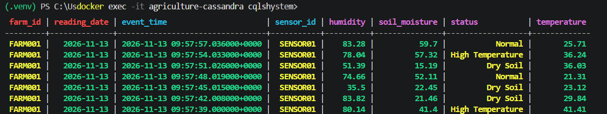
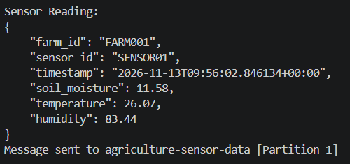
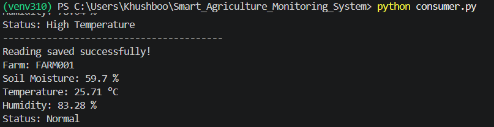
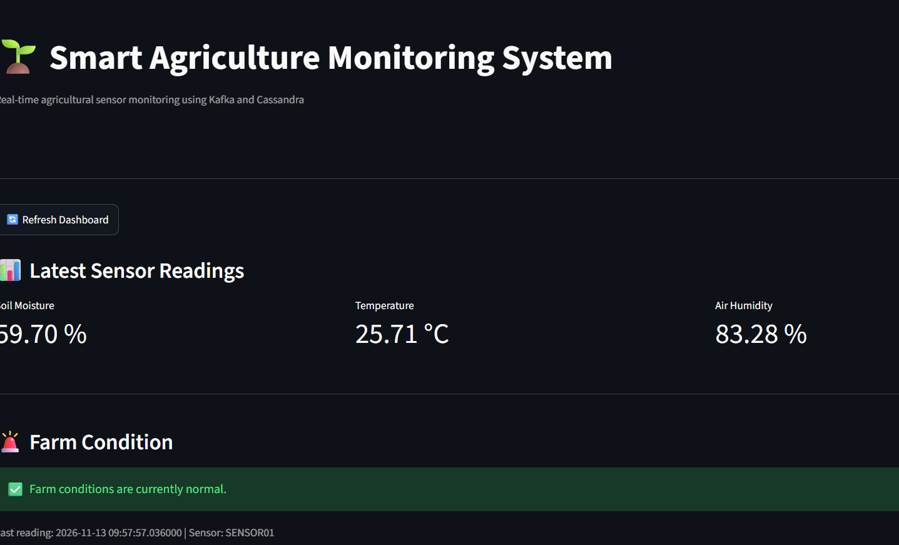

# 🌱 Smart Agriculture Monitoring System

A real-time IoT-based agriculture monitoring system built using **Python, Apache Kafka, Apache Cassandra, and Streamlit**.

This project simulates farm sensors that collect environmental data and helps monitor soil moisture, temperature, and humidity. Sensor readings are transmitted through Kafka, stored in Cassandra, and displayed on an interactive dashboard.

## 🚀 Project Overview

The Smart Agriculture Monitoring System helps farmers monitor important environmental conditions and identify situations that may require attention.

It demonstrates how real-time data processing and distributed technologies can be used in smart farming.

## 🏗️ System Architecture

**Data Flow:**

Python Sensor Producer → Apache Kafka → Python Consumer → Apache Cassandra → Streamlit Dashboard

### How It Works

1. **Sensor Producer:** Generates simulated soil moisture, temperature, and humidity readings.
2. **Apache Kafka:** Receives and transports real-time sensor messages.
3. **Python Consumer:** Reads Kafka messages, processes sensor data, and identifies alerts.
4. **Apache Cassandra:** Stores sensor readings for future analysis.
5. **Streamlit Dashboard:** Displays the latest readings, alerts, graphs, and historical data.

## 🛠️ Technologies Used

| Technology | Purpose |
|---|---|
| Python | Application development |
| Apache Kafka | Real-time data streaming |
| Apache Cassandra | NoSQL database |
| Streamlit | Interactive dashboard |
| Pandas | Data handling |
| Plotly | Data visualization |
| Docker | Running Kafka and Cassandra |
| Git & GitHub | Version control |

## ✨ Key Features

- Real-time simulated sensor data generation.
- Kafka-based data streaming.
- Cassandra database integration.
- Soil moisture monitoring.
- Temperature and humidity monitoring.
- Automatic condition classification.
- Dashboard with charts and latest readings.
- Historical sensor data storage.
- CSV data export.

## 📸 Project Screenshots

### Docker Containers


### Sensor Producer


### Kafka Consumer


### Monitoring Dashboard


## ⚙️ Installation and Setup

### 1. Clone the Repository

```bash
git clone https://github.com/khushboo746/Smart-Agriculture-Monitoring-System.git
cd Smart-Agriculture-Monitoring-System
```

### 2. Create a Virtual Environment

```bash
python -m venv venv310
```

Activate it on Windows:

```powershell
.\venv310\Scripts\Activate.ps1
```

### 3. Install Dependencies

```bash
pip install -r requirements.txt
```

### 4. Start Docker Services

Make sure Docker Desktop is running.

```bash
docker compose up -d
```

### 5. Create the Kafka Topic

```bash
docker exec agriculture-kafka /opt/kafka/bin/kafka-topics.sh --create --topic agriculture-sensor-data --bootstrap-server localhost:9092
```

If the topic already exists, you can skip this step.

### 6. Run the Sensor Producer

Open a terminal and execute:

```bash
python producer.py
```

### 7. Run the Consumer

Open another terminal and execute:

```bash
python consumer.py
```

### 8. Launch the Dashboard

Open another terminal and execute:

```bash
streamlit run dashboard.py
```

The dashboard will open in your browser.

## 🚨 Alert Conditions

The project uses demonstration thresholds:

- Soil moisture below 30%: Dry Soil Alert.
- Temperature above 35°C: High Temperature Alert.
- Otherwise: Normal.

These are example thresholds and should be adjusted according to crop requirements and actual agricultural conditions.

## 🔮 Future Improvements

- Integration with ESP32 and physical sensors.
- Live soil moisture sensor readings.
- Weather API integration.
- AI-based crop recommendations.
- Smart irrigation automation.
- Mobile application integration.

## 👩‍💻 Author

**Khushboo Chauhan**

B.Sc. Artificial Intelligence Student

- GitHub: [khushboo746](https://github.com/khushboo746)
- LinkedIn: [Khushboo Chauhan](https://www.linkedin.com/in/khushboo-chauhan-15b1453a0/)

---

⭐ If you find this project interesting, feel free to explore the repository!